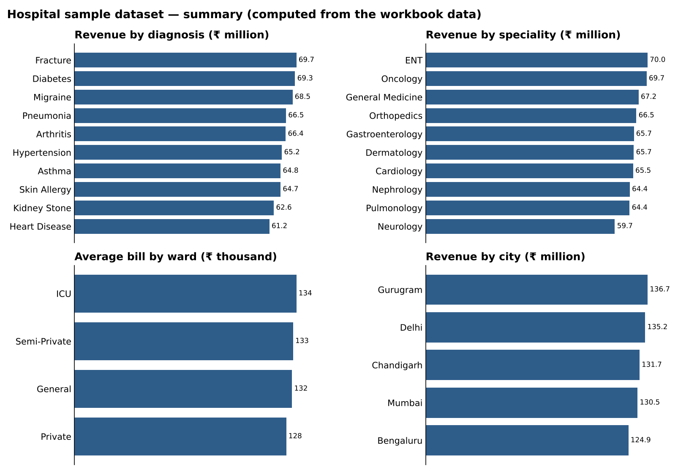

# 🏥 Hospital Revenue & Operations Dashboard

An interactive Excel dashboard for a multi-city hospital group, covering revenue, diagnoses, doctor and speciality performance, ward usage and length of stay.

> **Data note:** the dataset is a *sample / synthetic* dataset for analysis practice. It contains no real patient information.

*Summary charts computed from the workbook's data.*

## Contents
- [Headline numbers](#headline-numbers)
- [Business questions](#business-questions)
- [Dataset](#dataset)
- [Workbook structure](#workbook-structure)
- [Key observations](#key-observations)
- [Excel techniques used](#excel-techniques-used)
- [How to use](#how-to-use)

## Headline numbers
| Metric | Value |
|---|---|
| Admissions | **5,000** |
| Total billed revenue | **₹658,836,826** (≈ ₹65.9 crore) |
| Average bill | **₹131,767** |
| Average length of stay | **5.5 days** |
| Doctors | 250 |
| Specialities · diagnoses · cities | 10 · 10 · 5 |
| Period | Jan 2024 – Jun 2026 |

## Business questions
1. Which **diagnoses and specialities** generate the most revenue?
2. Which **doctors** treat the most patients, and what is the average revenue per doctor?
3. How do **bill size and length of stay** vary by ward type and city?
4. How does revenue trend by **month and year**?

## Dataset
One row per admission: patient ID, doctor ID, speciality, admission and discharge dates, diagnosis, ward type (General / Semi-Private / Private / ICU), city and bill amount (₹). *Admission year*, *admission month* and *days stayed* are calculated columns.

## Workbook structure
| Sheet | Purpose |
|---|---|
| `Fortis Hospital Data` | Source data (5,000 rows) |
| **Executive Overview** | Revenue, patients, average bill, average stay |
| **Patient & Diagnosis Analysis** | Patients and revenue by diagnosis |
| **Doctor & Speciality Performance** | Top doctors, revenue per doctor, speciality comparison |
| **Revenue & Hospital Operations** | Ward, city, days-stayed and revenue-per-day views |
| Supporting sheets | PivotTable calculation sheets feeding the dashboards |

26 PivotTables · 19 charts · 4 slicers.

## Key observations
*(from the sample data — segments are close together, as is typical of synthetic data)*
- **Fracture** (₹69.7M), **Diabetes** (₹69.3M) and **Migraine** (₹68.5M) are the top revenue diagnoses; **ENT** (₹70.0M) and **Oncology** (₹69.7M) lead by speciality.
- **Gurugram** (₹136.7M) and **Delhi** (₹135.2M) are the highest-revenue cities; Bengaluru is lowest (₹124.9M).
- Average bill is highest in **ICU** (₹134K) and lowest in **Private** (₹128K); length of stay is ≈5.5 days in every ward.
- Revenue by admission year: 2024 ₹270.5M (2,066 admissions) · 2025 ₹265.2M (1,990) · 2026 (to June) ₹123.1M (944).

## Excel techniques used
- PivotTables and slicers for cross-filtering
- KPI cards with `XLOOKUP`, `MAX`, `AVERAGE`, `ROUND`
- Calculated columns (`YEAR`, `TEXT`, date arithmetic for days stayed)
- Multi-page dashboard design

## How to use
1. Download `Hospital_Operations_Dashboard.xlsx`.
2. Open in **Excel 365 / 2021+** (uses `XLOOKUP`).
3. Use the slicers to filter by city, ward, speciality or year.
4. Refresh the PivotTables after changing the source data.

---
Built by **Harshit** · [Profile](https://github.com/YOUR-USERNAME)
